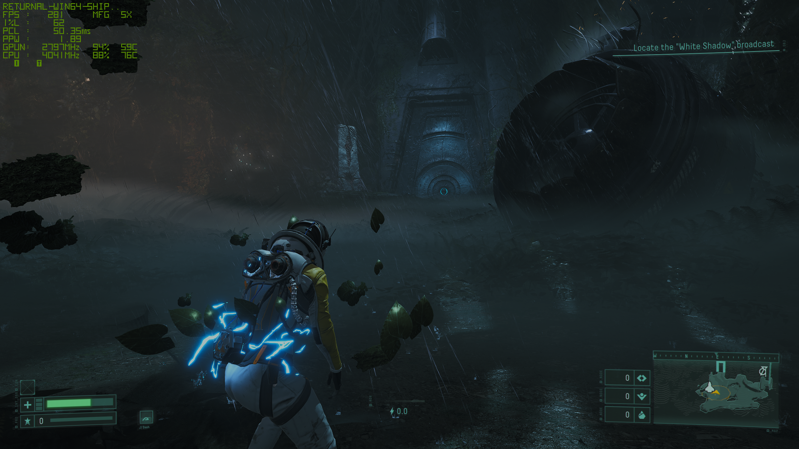

# Returnal on Streamline 2.14 — DLSS Multi-Frame Generation bridge

Returnal ships an NVIDIA **Streamline 1.3.3** integration and refuses newer Streamline
runtimes. Modern driver features — DLSS **Multi-Frame Generation (MFG)** — are only
exposed through **Streamline 2.x** integrations.

This project is a compatibility bridge: a DLL installed as the game's
`sl.interposer.dll` that loads a **genuine Streamline 2.14 stack** from a neighbouring
`sl2\` folder and translates the game's SL 1.3.3 API calls onto SL 2.x at runtime.
No game executable is patched for code flow; NVIDIA binaries are neither modified nor
redistributed.

**Verified result — NVIDIA FrameView: `FPS 281 · MFG 5x`** (2560×1440, game rendering
~56 fps; the multiplier is forced non-dynamically via the bridge ini — see
[Configuration](#configuration)).



## Status

| item | value |
| --- | --- |
| Game | Returnal (Steam, DX12) |
| Runtime | Streamline **2.14.16** `b742680bf` PRODUCTION — plugins `sl.common`, `sl.dlss_g`, `sl.reflex`, `sl.pcl` |
| NGX identity | the game's real application id (`195018064`) relayed to SL2/NGX |
| Features verified | DLSS-G **on**, NGX `nvapp_override` builds detected (SR override path live), Reflex on with markers |
| Verified | **MFG 5x @ 281 FPS** (`ForceMode=1`, `ForceNumFrames=4`), stable multi-minute runs, clean exit, no crash dumps |
| Pre-fix state | NGX disabled, DLSS-G unsupported, frame generation never generated — see [`evidence/PRE-FIX-excerpts.txt`](evidence/PRE-FIX-excerpts.txt) |

Full engineering log with log-line evidence: **[FINDINGS.md](FINDINGS.md)**.

## How it works

```
Returnal.exe + Returnal-Streamline* modules
        |  expects the SL 1.3.3 API surface and imports it from sl.interposer.dll
        v
sl.interposer.dll  ==  sl1_bridge.dll   <-- this project
        |  loads  <game>\Engine\Plugins\Streamline\Binaries\ThirdParty\Win64\sl2\sl.interposer.dll
        |  (absolute path) and translates every call, structure, id and marker
        v
sl2\sl.interposer.dll   (genuine Streamline 2.14.16)
        v
sl2\sl.common.dll / sl.dlss_g.dll / sl.reflex.dll / sl.pcl.dll  ->  NGX / driver providers
```

* The bridge keeps the file name the game loads and re-exports the complete SL 1.3.3
  export surface (195 names: 39 mapped to real work, 156 verified-unused stubs).
* The game's modules also resolve `D3D12CreateDevice`, `CreateDXGIFactory*`, … from
  `sl.interposer.dll`; those are forwarded to the genuine interposer's DXGI/D3D proxies.
* The game's render modules are SL1-era, so all viewports are canonicalised to
  viewport `0` and SL1 "sticky" tags are replayed each frame.

The four problems that had to be solved along the way (loader gate, NGX application
identity, reflex marker submission API, viewport/instrumentation correctness) are
documented with before/after log evidence in [FINDINGS.md](FINDINGS.md).

## Install

### Fastest path (release binaries)

1. Copy the game's stock interposer out of the way (backup):
   `…\Engine\Plugins\Streamline\Binaries\ThirdParty\Win64\sl.interposer.dll`
2. Copy `sl1_bridge.dll` from the release into that folder **renamed as**
   `sl.interposer.dll`.
3. Copy `sl_bridge.ini` next to it.
4. Create a sub-folder `sl2\` and place a genuine Streamline 2.x payload inside
   (`sl.interposer.dll`, `sl.common.dll`, `sl.dlss_g.dll`, `sl.reflex.dll`,
   `sl.pcl.dll`, `sl.dlss*.dll`, `nvngx_*.dll` — taken from an installed SL2 title).
5. Patch the loader gate once (3 bytes, reversible):
   `python bridge/patch_gate.py "<game>\Returnal\Binaries\Win64\Returnal-StreamlineRHIPreInit-Win64-Shipping.dll"`
6. Launch the game normally (Steam). Logs: `sl_bridge.log` and `sl2logs\<pid>\sl.log`
   next to the plugin folder.

### Harness (this repository)

`bridge/install.ps1` automates all of the above (one-time stock backups,
bridge deployment, `sl2\` population, ini, gate patch; `-Remove` restores).
Edit its three path variables first:

| variable | meaning |
| --- | --- |
| `$Game` | Returnal install folder (Steam) |
| `$ref`  | folder holding a genuine SL 2.x payload to copy into `sl2\` |
| `$src`  | this repository's `bridge/` folder (built `sl1_bridge.dll` + `sl_bridge.ini`) |

`bridge/run_test.ps1 -Mods Off -Wait 150` performs a clean instrumented launch
(clears logs, launches via Steam, dumps evidence); `bridge/mod_toggle.ps1 -On/-Off`
toggles other proxy DLLs out of the way.

## Configuration

`sl_bridge.ini` (shipped defaults shown; they are the verified MFG 5x configuration):

| key | default | meaning |
| --- | --- | --- |
| `LogLevel` | `2` | 0 errors / 1 state changes / 2 every call (throttled) |
| `PluginDir` / `LogDir` | `sl2` / `sl2logs` | paths relative to the bridge |
| `ForceMode` | `1` | DLSS-G mode: -1 game's choice, 0 off, 1 on, 2 auto, 3 dynamic |
| `ForceNumFrames` | `4` | frames to generate: -1 game's choice, 1..5 (= 2x..6x). **4 → 5x** |
| `ForceDynamicFPS` | `0` | dynamic MFG target fps (0 = auto/detect) |
| `ForceFlags` | `-1` | raw DLSSGFlags override |
| `EnableUIRecomposition` | `1` | use tagged UI buffer for frame generation |
| `ForwardReflex` / `AutoReflexWithFG` | `1` / `1` | Reflex translation; force Reflex on when the game enables FG |
| `DXGIFactoryProxy` | `1` | SL2 uses a DXGI factory proxy (overlay-injection friendly) |
| `CanonicalViewport` | `1` | collapse all viewport ids onto 0 (single-view game) |
| `HostSDK` | `1.5.0` | host SDK version reported to SL2 (legacy-title semantics) |
| `LogPerProcess` | `1` | `sl2logs\<pid>\sl.log` per process |
| `AppId` | `-1` | -1 = relay the game's `slInit` application id; `>=0` = force |
| `ProjectId` | `0` | non-empty = use NGX `Init_with_ProjectID` path (skips app-id check) |

Set `ForceMode=-1` / `ForceNumFrames=-1` to let the game's own setting drive
(that path runs the 2x baseline).

## Evidence

| file | what it shows |
| --- | --- |
| [`evidence/frameview-mfg5x-281fps.png`](evidence/frameview-mfg5x-281fps.png) | FrameView: **FPS 281, MFG 5x** in-game (2560×1440) |
| [`evidence/bridge-log-final-x5-run.txt`](evidence/bridge-log-final-x5-run.txt) | the bridge's own log: app-id relay, feature-function resolution (`reflexSetMarker=1`), forced `frames=4`, DLSS-G state `status=0x0 … max=5` |
| [`evidence/sl2-log-final-x5-run.txt`](evidence/sl2-log-final-x5-run.txt) | genuine SL 2.14 log of the same run: plugin loads, NGX `nvapp_override`, clean exit |
| [`evidence/PRE-FIX-excerpts.txt`](evidence/PRE-FIX-excerpts.txt) | the failure state: NGX disabled over the application id, marker calls rejected without a viewport handle |

Headline before/after numbers are tabulated in [FINDINGS.md](FINDINGS.md).

## Build from source

Requirements: Visual Studio 2022 (x64), Python 3, Streamline 2.x SDK headers.

1. Edit `set SDK=` in `bridge/build.bat` to point at a Streamline 2.x `include` folder.
2. Run `bridge/build.bat` — `gen_def.py` regenerates `sl1_bridge.def` from
   `bridge/interposer133_exports.txt` (the stock SL 1.3.3 interposer's export list),
   then `cl` produces `sl1_bridge.dll` (195 exports, 39 mapped).

## Caveats

* Verified on a single machine/config (RTX 50-series, DLSS-override-capable driver,
  2560×1440). Other systems/driver versions may need ini adjustments.
* No game files and no NVIDIA binaries are redistributed here. You supply your own
  copies (the game, and a legitimate Streamline 2.x payload from another title).
* `patch_gate.py` flips one 3-byte function inside one game DLL — the installer backs
  the file up first and `install.ps1 -Remove` restores everything.
